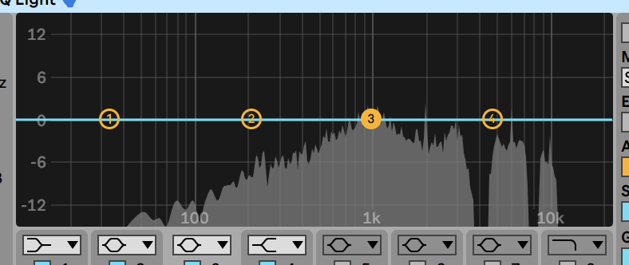
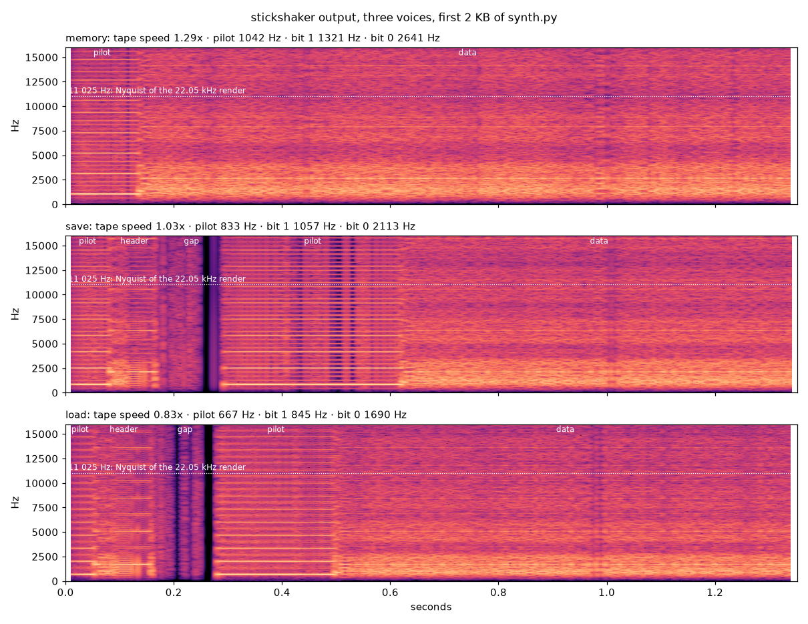
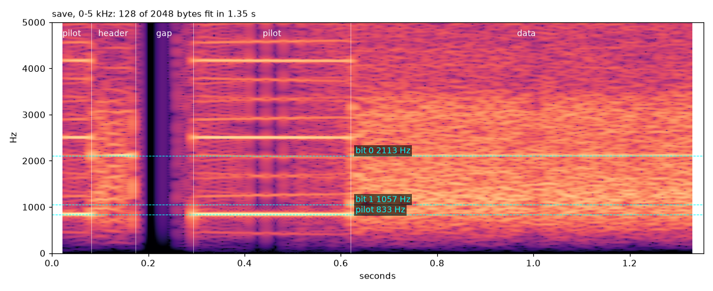

# stickshaker sound design

This document describes how the data of an event controls the sound. It also gives the reasons for the sound design, and the signal flow inside `synth.py`.

For the components, the contracts, and the constants, see [ARCHITECTURE.md](ARCHITECTURE.md).

## Goals

- **Short.** A sound is 0.5 to 4 seconds long. It must not interrupt your work.
- **Easy to identify.** You can hear the kind of event (`memory`, `save`, `load`) in the first 100 ms.
- **Made from the data.** The bytes of the event make the signal. Different data makes a different sound.
- **Deterministic pitch.** The same content always gets the same pitch. The noise is random, so two renders are not identical.
- **Recognizable.** The ZX Spectrum loading sound is a well-known sign of "the computer is saving or loading". This agrees with memory writes and compaction.

## Data to sound

Each aspect of the event controls one or more parts of the sound.

| Aspect of the data | Sonic feature | You hear | Code |
|---|---|---|---|
| Event kind | Tape speed (pitch), header block, minimum pilot share | `memory` is high and has one block. `save` and `load` have two blocks with a silent gap between them. `load` is the lowest. | `VOICES` |
| Logical size (`size`) | Duration | Larger events are longer. Duration increases with the log of the size, from 0.5 s to 4 s. | `target_seconds()` |
| Logical size (`size`) | Size turbo (pitch) | Larger events are a little higher, a maximum of 1.4 × at 256 KB. | `size_turbo()` |
| Logical size (`size`) | Header block bytes | The header contains the size, so `save` events of different sizes have different header bursts. | `header_block()` |
| Content hash | Pitch offset, ±10 % | Each content has its own pitch. The same content always has the same pitch. | `content_pitch()` |
| Byte values (bits) | Frequency-shift pattern: bit 1 is a tone at approximately 1 kHz, bit 0 at approximately 2 kHz | The data section. Different bytes make a different texture. | `bit_pulses()` |
| Number of 1 bits | Data rate | A bit 1 takes 2 times longer than a bit 0. Data with many 1 bits plays fewer bytes in the same time. | `bit_pulses()`, `plan()` |
| Byte value (0 to 255) | Noise level, cubed | ASCII text gives soft grit. Bytes above `0x7F` (UTF-8 characters, binary data) give loud noise spikes. | `DATA_NOISE` in `grit()` |
| Newline bytes | Silent pauses of 6 ms at real speed | Code with short lines stutters. Prose plays in long runs. JSON on one line plays without pauses. | `LINE_GAP_T` |
| Payload length compared to duration | Pilot length and data cut | A small payload gives a long pilot tone and a short data burst. A large payload gives the minimum pilot, and the data stops at the end of the time. | `plan()` |

The tape speed sets the pitch. The target duration sets the length. These two are independent: the pilot tone and the data cut absorb the difference. For the reason, see "Encoding" in [ARCHITECTURE.md](ARCHITECTURE.md).

The data is not compressed. Compression removes the line structure, and then all data sounds the same.

## Reference spectrum

This is the average spectrum of a recording of real ZX Spectrum tape audio, from a spectrum analyzer. It is the target for the output tone curve. The horizontal axis is frequency on a log scale (100 Hz, 1 kHz, 10 kHz). The vertical axis is level in dB, with 0 dB at the peak.



The frequencies below are read from the screenshot. They are approximate.

| Band | Level | Shape |
|---|---|---|
| Below 40 Hz | None | No energy. |
| 40 Hz to 800 Hz | −15 dB rising to −1 dB | A steady rise of approximately 6 dB per octave. |
| 800 Hz to 1.8 kHz | Approximately 0 dB | Flat. This is the main band. |
| Approximately 2 kHz | Above 0 dB | One sharp peak. This is the bit 0 tone (2047 Hz at real speed). |
| 2 kHz to 3.8 kHz | 0 dB falling to −10 dB | Gradual fall. |
| 3.9 kHz to 4.5 kHz | None | Deep notch. |
| 4.6 kHz to 7.6 kHz | −3 dB to −12 dB | A second band, with a peak near 5 kHz. |
| 7.6 kHz to 8.9 kHz | None | Deep notch. |
| 8.9 kHz to 11 kHz | Approximately −8 dB | A third, narrow band. |
| Above 11 kHz | None | No energy. |

### What the reference shows

1. **The tape signal is a mid-range sound.** Most energy is between 800 Hz and 2 kHz. There is little bass.
   Design result: `tone()` uses a 2nd-order high-pass at 700 Hz. It removes the low end and is flat from just below 1 kHz.

2. **The bit 0 tone is the only sharp peak.** The bit 1 tone (1023 Hz) is inside the flat main band and does not show as a separate peak.
   Design result: the bit timings come from the ROM without changes. The data section must keep a strong 2 kHz component. For this reason, the tape low-pass is at 8 kHz, not lower.

3. **The notches are probably at the even harmonics of the bit tones.** A square wave with equal half-pulses has only odd harmonics. Bit 1 (1 kHz) has energy at 1, 3, 5, 7, 9 kHz. Bit 0 (2 kHz) has energy at 2, 6, 10 kHz. Neither tone has energy at 4 kHz or 8 kHz. The two notches are near these frequencies.
   Design result: the synth makes square waves with equal half-pulses, as the ROM does. The noise, the aliasing, and the wow/flutter fill these notches in the stickshaker output. A notch filter in `tone()` can make them again (see "Open items").

4. **There is no energy above 11 kHz.** The recording is probably at 22.05 kHz, or the tape removes the top band.
   Design result: stickshaker renders at 22.05 kHz (`CRUSH_RATE`), as the reference does. But stickshaker keeps the aliasing images above 11 kHz on purpose, for a brighter, lo-fi top. This is a difference from the reference.

## Spectrograms

The two images show the output of `render()` for the first 2 KB of `stickshaker/synth.py`. At 2 KB, the duration is 1.35 s for each voice. The colour scale is the same for all panels (−140 dB to −40 dB).

### Three voices



| Voice | Tape speed | Pilot | Bit 1 | Bit 0 | Data bytes that fit |
|---|---|---|---|---|---|
| `memory` | 1.29 × | 1042 Hz | 1321 Hz | 2641 Hz | 265 |
| `save` | 1.03 × | 833 Hz | 1057 Hz | 2113 Hz | 128 |
| `load` | 0.83 × | 667 Hz | 845 Hz | 1690 Hz | 119 |

### One `save` sound, 0 to 5 kHz



| Section | Time | Duration |
|---|---|---|
| Header pilot | 0.00 to 0.08 s | 82 ms |
| Header block (19 bytes) | 0.08 to 0.17 s | 91 ms |
| Gap | 0.17 to 0.29 s | 120 ms |
| Data pilot | 0.29 to 0.62 s | 328 ms |
| Data block (128 bytes + flag + checksum) | 0.62 to 1.35 s | 730 ms |

### What the spectrograms show

1. **The pilot is the only clear tone.** It shows as a set of horizontal lines. The strongest lines are the odd harmonics of a square wave (833, 2500, 4167 Hz for `save`). Weaker lines occur between them. These come from edges that snap to the 22.05 kHz sample grid, and from harmonics above 11 kHz that fold back.
   Design result: the identity of each voice is in the pilot. The voice speeds (0.8, 1.0, 1.25) put the three pilots at clearly different heights.

2. **The data section is broadband noise, not two tones.** The bit 1 and bit 0 lines do not show. One bit lasts for only one cycle of its tone (approximately 1 ms or 0.5 ms). An analysis window of 23 to 46 ms contains 25 to 50 bits, so the energy spreads from approximately 500 Hz to above 4 kHz. Most energy is between 900 Hz and 3 kHz.
   Design result: at full level, this noise covers the pilot tone. Thus the mix sets the data 6 dB below the pilot (`DATA_LEVEL`).

3. **The gap is the strongest sign of `save` and `load`.** The 120 ms gap is almost silent in all bands. Only the crackle clicks show, as thin vertical lines. `memory` has no gap.
   Design result: `memory` stays different from `save` and `load` even when the size turbo makes a large `save` higher than a small `memory`.

4. **The header burst is short.** It is 19 bytes, approximately 90 ms. It sounds like a chirp before the gap.

5. **Little energy below approximately 300 Hz.** This is the 700 Hz high-pass in `tone()`. The curve agrees with the reference spectrum: little energy below 100 Hz, then a rise to flat just below 1 kHz.

6. **Energy above 11 kHz is aliasing.** The sample-and-hold from 22.05 kHz to 44.1 kHz has no filter. It keeps a mirror image of the band below 11 kHz. This gives the bright, lo-fi top. It is intentional. The reference has no energy above 11 kHz.

7. **Vertical dark bands are dropouts.** For example, at 0.43 s and 0.46 s in the `save` pilot. They are the slow random gain dips (`DROPOUT`). They are not newline pauses: there are no newlines in a pilot.

8. **Newline pauses are too short to show.** At this tape speed, a pause is approximately 6 ms. The analysis window is longer. You hear the pauses as a rhythm, but the spectrogram does not show them clearly.

9. **Pilot share agrees with the voice minimum.** In this example the data is cut, so each pilot gets its minimum share: `memory` 10 %, `save` 30 %, `load` 20 %.

## Sound design notes

### Source signal

The source is the real ZX Spectrum ROM tape format: pilot tone, two sync pulses, then the bits. The timings are in Z80 T-states at 3.5 MHz (see "Encoding" in [ARCHITECTURE.md](ARCHITECTURE.md)). The synth does not imitate the sound. It makes a real tape signal from the bytes. Then it adds the tape and the lo-fi character.

The synth uses a naive square wave without a band limit. A clean, band-limited square sounds too modern. The aliasing gives the "8-bit" character.

### Voices

Each voice must be different from its first moment:

- **Pitch.** The voice speeds are 1.25, 1.0, and 0.8. The step between them (20 % to 25 %) is larger than the content pitch range (±10 %). Thus the content does not move one voice into another.
- **Header.** `save` and `load` have a header block and a gap, as a real Spectrum `SAVE` does. `memory` has no header. It is a short, single event.
- **Pilot length.** `save` has the longest pilot (minimum 30 %). It sounds like "start of a save". `memory` has the shortest (minimum 10 %). It gets to the data quickly.

A compaction plays `save` and then `load`. The `load` is lower. Together, the two sounds go down in pitch.

### Tape character

The texture comes from noise that is not constant:

- Noise that follows each byte value. Most text bytes are quiet. Some bytes give spikes.
- Grains of noise that switch on and off (2 to 20 ms).
- Sparse crackle clicks after the low-pass, so they stay bright.
- Slow dropouts, and a slow wow/flutter (0.3 % at 0.5 Hz).

All noise is cubed Gaussian noise. It is mostly quiet with sharp peaks. Constant white noise sounds like a hiss on top of the signal. Cubed noise sounds like a worn tape.

### Constraints

- **Each half-pulse must be longer than one sample** at `CRUSH_RATE`. If not, the bit pattern does not show, and the data becomes a wash of noise. At 22.05 kHz and 1.4 × turbo, the shortest half-pulse (bit 0) is approximately 4 samples. `MAX_TURBO` and `CRUSH_RATE` must change together.
- **`CRUSH_RATE` must divide 44100 exactly.** If not, the hold count changes in a pattern, and this pattern adds a buzz (for example, 100 Hz at 8000 Hz).
- **The tape low-pass must stay above the bit tones.** At 8 kHz it softens the edges but keeps the bit tones clear. An earlier value of 800 Hz made a wash in the low-mid frequencies.
- **Level.** The output level is `AMP` (0.1). There is no volume control. The macOS system volume controls the final level.

### Open items

- The reference spectrum has deep notches at approximately 3.9 to 4.5 kHz and 7.6 to 8.9 kHz. `tone()` does not have them yet. The spectrograms above show no dips at these frequencies.

## Signal flow in the synth

```
 data, size, kind
       │
       ▼
┌──────────────────────────────────────────────────────────────┐
│ plan()                                                       │
│   kind ──▶ VOICES ──────────┐                                │
│   data ──▶ content_pitch() ─┼─▶ tape speed ──▶ scale         │
│   size ──▶ size_turbo() ────┘                                │
│   size ──▶ target_seconds() ──▶ total duration               │
│   header_block() + data_block() ──▶ blocks                   │
│   cut the data to fit, rest to the pilot ──▶ pilot counts    │
└──────────────────────────────┬───────────────────────────────┘
                               │ Plan(blocks, pilot_counts, scale, gap_secs)
                               ▼
┌──────────────────────────────────────────────────────────────┐
│ render(), for each block                                     │
│   block_pulses() ──▶ half-pulse lengths (T-states)           │
│                  └─▶ levels: byte/255, -1 pilot/sync,        │
│                      -2 newline pause                        │
│   square()  ±1 square at 22.05 kHz, wow/flutter              │
│   join the blocks, with a silent gap between them            │
└──────────────┬──────────────────────────────┬────────────────┘
               │ wave                         │ levels (control)
               ▼                              │
┌──────────────────────────────────────────────┼───────────────┐
│ crush()                                      │               │
│   grit()                                     │               │
│     + noise × (hiss + byte value³ + grains) ◀┤               │
│     one-pole low-pass, 8 kHz                 │               │
│     × dropouts                               │               │
│     + crackle                                │               │
│   quantize to 4 bits                         │               │
│   × mix: data 0.5, pilot/sync 1.0 ◀──────────┤               │
│   × newline gate: pause = 0 ◀────────────────┘               │
│   sample-and-hold, 22.05 ──▶ 44.1 kHz (no filter)            │
│   tone(): high-pass, 700 Hz, 2nd order                       │
│   × AMP (0.1), fade in 30 ms, fade out 5 ms                  │
└──────────────────────────────┬───────────────────────────────┘
                               ▼
                    float32 samples, 44.1 kHz, mono
```

The `levels` array is a control signal. It moves in parallel with the wave, at the same sample rate. It controls three things: the data noise level, the mix level, and the newline gate.
